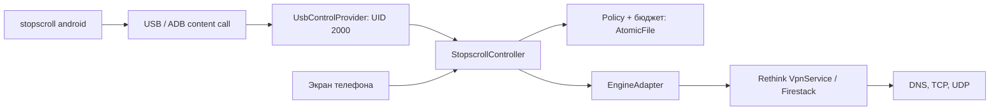

# Stopscroll Android: VpnService, дневные лимиты и управление по USB

Дата: 2026-11-17. Статус: согласовано пользователем, выполняется технический этап G0.

## 1. Цель и границы

Приложение на телефоне самостоятельно блокирует заданные сайты и даёт выбранным
группам дневной бюджет. Компьютер по явно запущенной команде ADB читает и меняет
список, настройки и состояние сессий. После отключения USB всё работает локально.
Другой VPN пользователю сейчас не нужен.

В первую версию входят:

- постоянные запреты, исключения внутри групп и дневные лимиты;
- ручной импорт действующей конфигурации сайтов компьютера, включая ограниченные
  группы; конфигурация YouTube/X сохраняет их бюджеты, но расход не переносится;
- открытие и закрытие отрезков на телефоне и по USB;
- небольшой экран состояния, остатка бюджета и открытия отрезка;
- ручные команды установки/обновления APK и диагностики;
- восстановление после перезапуска приложения, сна и загрузки телефона.

Не входят: автоматические действия при подключении USB, фоновая синхронизация,
облачный сервер, общий бюджет устройств, Telegram-каналы, root, разблокировка
загрузчика, HTTPS-перехват с установкой сертификата и измерение внимания пользователя.
Очередь ослаблений на 45 минут и бонусные минуты в этой версии тоже не реализуются:
изменения через доверенный ADB применяются сразу. Это отдельное отличие от desktop.

Цель приёмки — Android 13, основной пользователь 0, arm64-v8a. Более широкий
диапазон версий Android не объявляется поддержанным без проверки.
Пользователь уточнил при реализации: сейчас проверяем только Wi-Fi; мобильные
данные и роуминг остаются выключенными. На доступной сети нет глобального IPv6,
поэтому мобильная сеть и реальный IPv6 отмечаются непроверенными, а не успешными.

## 2. Выбор основы

| Основа | Оценка для проекта |
| --- | --- |
| **Небольшой форк Rethink с собственным модулем Stopscroll** | Предлагаемый вариант: готовые VpnService, DNS и обработка TCP/UDP, домены, IPv4/IPv6 и закрытие соединений. Дописываем правила, бюджеты, экран и ADB-интерфейс. |
| Форк NetGuard | Возможен, но соответствие требуемому Always-on/lockdown и доменной фильтрации придётся отдельно доказывать. |
| Собственный VPN-стек или только DNS | Первый существенно увеличивает сетевую часть проекта; второй сохраняет известные обходы через соединения и альтернативный DNS. |

Исследованный кандидат: Rethink `v0.5.8`, commit
`b750334a363065b94f83e818ac5dc38048713c1f`, не движущаяся ветка main.
В его `gradle.properties` закреплён Firestack `d3d530ea3e`, репозиторий `ossrh`.
На подготовительном этапе разрешаем сокращённый SHA Firestack в полный SHA,
фиксируем SHA-256 AAR и toolchain в lock-файле. Нельзя незаметно заменить движок
на main, если артефакт не скачивается.
Для корректного отсечения соединений используется адресный локальный патч
к тому же закреплённому upstream-коммиту Firestack: admission generation меняется
перед закрытием TCP/UDP-потоков и проверяется после регистрации, до передачи данных.
Захваченные DNS-сокеты входят в тот же барьер. Исходный AAR, патч и собранный AAR
имеют раздельные хеши и воспроизводимый provenance с регрессионными тестами.
Переход на другую версию движка или замена этих хешей без исходников не допускаются.

Это кандидат с обязательным техническим допуском G0, а не обещание успешной сборки.
Наличие API закрытия соединений в исходниках не доказывает его работу на телефоне.
Если G0 не проходит, останавливаем следующие этапы и пересматриваем основу.

Схема распространения как у патча Telegram: upstream checkout вне публикуемых
исходников, точный lock-файл, патч и сборочные скрипты в Stopscroll. Сохраняются
уведомления Apache-2.0 Rethink и лицензии всех включённых зависимостей; отчёт
о зависимостях обязателен. APK подписывается отдельным постоянным локальным ключом,
ключ и пароли не попадают в Git. Пакет: `com.celzero.bravedns.stopscroll`, название
«Stopscroll», указание происхождения в About. Rethink с другим package ID не заменяется.

## 3. Компоненты и потоки данных



`StopscrollController` — единственный писатель конфигурации и бюджета. UI и USB
используют его методы, сетевые callbacks читают неизменяемый снимок состояния.
Controller, provider и VpnService работают в одном процессе приложения.
Свой сетевой сервер и ADB port forwarding не нужны.

Режим Rethink: DNS + Firewall, без исключённых приложений, внешних прокси,
туннелей WireGuard и дополнительных рекламных блоклистов. Правила Stopscroll
проверяются перед разрешающими правилами upstream. Открытая сессия снимает только
запрет своей группы и не отменяет запрет другой совпадающей группы.
Подробный журнал посещений и телеметрия по умолчанию выключены.

Разрешённый DNS передаётся upstream-резолверу `https://cloudflare-dns.com/dns-query`;
при первом запуске показываем его адрес. G0 проверяет bootstrap без рекурсивного
запроса через собственный VPN и переходы между сетями. Не переключаем DNS-провайдера
молча при ошибке. Списки запретов и бюджет остаются на устройстве; DNS-резолвер,
как обычно, видит передаваемые ему разрешённые DNS-запросы.

## 4. Модель правил

Экспортируемая конфигурация, пример без персональных списков:

```json
{
  "schema": 1,
  "reset_hour": 4,
  "default_session_min": 15,
  "sites": {
    "video": {
      "mode": "limited",
      "budget_min": 45,
      "domains": ["video.example.org"],
      "exceptions": ["accounts.video.example.org"]
    },
    "news": {
      "mode": "blocked",
      "budget_min": 0,
      "domains": ["news.example.org"],
      "exceptions": []
    }
  }
}
```

Нормализация совпадает с desktop: ASCII IDNA, нижний регистр, без конечной точки;
CLI принимает URL и удаляет начальное `www.` существующим `normalize_domain`.
Телефон принимает только уже нормализованные домены. Домены охватывают себя и
поддомены по границе метки: `a.example.org` совпадает с `example.org`,
`notexample.org` не совпадает. Запрещены IP вместо домена, маски, публичные суффиксы
без второй метки, неправильные имена и неизвестные поля схемы.

Исключение относится только к своей группе. Если другая группа явно блокирует
исключённый домен, её запрет сохраняется. Открытие одной из двух перекрывающихся
групп не открывает вторую. Исключения должны лежать внутри доменов своей группы;
импорт невалидной старой конфигурации даёт понятную ошибку, не исправляет её молча.

Конфигурация ограничена 100 группами, 1 000 суммарными записями domains/exceptions
и 64 KiB канонического UTF-8 JSON. Бюджеты limited: 1–1440 минут; blocked: 0.
ID группы соответствует desktop `^[a-z][a-z0-9]{0,23}$`, default_session_min: 1–1440.
Бюджет расходуется совместно всеми доменами группы. Телефон хранит свой расход,
desktop — свой. Например, 45 минут на каждом устройстве не означают общий лимит 45.

Смена конфигурации не обнуляет расход. История удалённой группы сохраняется по её
ID; удаление и повторное добавление того же ID в тот же день не выдаёт бюджет снова.
Новый ID считается новой группой: ADB является доверенным административным каналом.
Уменьшение бюджета ниже расхода даёт нулевой остаток, а не отрицательный.
Расход и tombstones храним только за текущий день, максимум для 1 000 ID; превышение
отклоняет добавление нового ID, не удаляет расход существующего. Новый день очищает
прошлые tombstones. Суточная смена не сбрасывает монотонную revision.

## 5. Дневные лимиты и время

- Вне открытого отрезка limited-группа закрыта, даже если бюджет ещё есть.
- Открытие резервирует минимум из запрошенного времени, доступного остатка и времени
  до 04:00. Только после записи резерва на диск может появиться разрешение в фильтре.
- Считается время открытого отрезка, включая фон и сон, а не активность браузера.
  Реклама, буфер и кэш не дают надёжного способа измерить фактический просмотр.
- Раннее закрытие возвращает неиспользованный резерв с округлением расхода вверх
  до секунды. Повторное закрытие не возвращает его второй раз.
- UI различает фактический остаток дня и резерв текущего отрезка. После 2 минут
  десятиминутного отрезка из бюджета 45: осталось 43 минуты, из них 8 в текущем
  отрезке и 35 не зарезервированы. Резерв не показывается как уже просмотренное время.
- Одна сессия на группу. Повторный open при активной сессии возвращает
  `SESSION_ACTIVE`; закрыть и открыть заново можно с учётом оставшегося бюджета.
- Сессия не пересекает суточную границу: в 04:00 закрывается, новый бюджет требует
  нового открытия. Начальное значение reset_hour импортируется, но иные значения
  в v1 отклоняются; смена часового пояса не происходит при каждом USB-подключении.
- Часовой пояс фиксируется при первом запуске по системному ZoneId и показывается
  в UI/status. Deadline сессии определяется `elapsedRealtime()`, учитывающим сон.
  Календарь используется только для дня бюджета. Возврат часов назад не создаёт
  новый день; перевод вперёд остаётся обходом в модели доверенных системных часов.
- При смерти процесса на том же boot сессия восстанавливается только с действующим
  монотонным deadline и сохранённым резервом. После перезагрузки все сессии закрыты,
  незавершённый резерв остаётся списанным. Это исключает бесплатное время через reboot,
  но перезагрузка может стоить оставшейся части открытого отрезка.
- Во время активных отрезков controller держит ограниченный по времени PARTIAL_WAKE_LOCK
  до ближайшего deadline с переустановкой для оставшихся сессий. Это осознанная цена
  точного закрытия в Doze. На G0 измеряем её и проверяем реальное закрытие; не заменяем
  его неточным alarm и не обещаем нулевое влияние на батарею.
  Для этого только Stopscroll должен быть исключён из battery optimization:
  без исключения Android в Doze игнорирует частичные wake locks. При настройке
  проверяем `PowerManager.isIgnoringBatteryOptimizations`; остальные приложения
  и глобальное энергосбережение не меняем.
- Предупреждение за 2 минуты, если отрезок длиннее 2 минут; отсутствие разрешения
  уведомлений не мешает сетевому закрытию. Разрешение VPN запрашивается стандартным UI.

Внутренний журнал содержит day_id, timezone, расход/резервы по ID группы, boot count,
start/deadline в elapsed time и revision. Журнал бюджета и конфигурация сохраняются
как единое атомарное состояние. Runtime не содержит доступных извне ключей/сокетов.

## 6. Применение и реальные гарантии фильтрации

DNS и callbacks соединений обращаются к одному PolicySnapshot. При добавлении
запрета, закрытии, истечении отрезка или смене правил:

1. Controller сериализует изменение, записывает и публикует новый снимок.
2. Адаптер инвалидирует старые разрешения внутри native-движка и закрывает текущие
   соединения. Коннект, разрешённый до изменения, не может начать передачу данных
   после обхода закрытия: после регистрации проверяется его admission generation.
3. `applied_revision` обновляется только после подтверждения операций адаптера.

Работающий движок и его доменные/IP-сопоставления сохраняются между изменениями
политики. Обычное изменение правил не создаёт новый native-контекст и TUN.
Уже начатое транспортное рукопожатие может завершиться, но устаревшее разрешение
не даёт пересылать данные приложения. Текущие передающие потоки закрываются обходом.

Для v1 допустимо закрывать все потоки движка при ужесточении: это надёжнее неполной
привязки IP к домену. Разрешённые приложения могут кратко переподключиться; при каждой
секунде учёта такого сброса нет. Во время перехода новые потоки временно закрываются.
Если адаптер не завершил обновление, статус `degraded`, сохранённая revision остаётся
видимой отдельно от applied; клиент не печатает «применено». При технической ошибке
адаптера запрещаем новые потоки и переводим весь туннель в режим drop. Если движок
не отвечает, TUN закрывается, а проверенный Android lockdown удерживает сеть закрытой.
Без включённого lockdown такая остановка показывается как unprotected, а не как
успешная блокировка. Производственный режим требует прошедшего приёмку lockdown.

На активном телефоне целевое закрытие — не позднее 2 секунд после deadline; G0 обязан
подтвердить TCP, UDP/QUIC и сон/пробуждение. Неограниченные по времени upstream API
нельзя считать подтверждённым применением только по успешному вызову обёртки.

VpnService не расшифровывает HTTPS. DoH приложений, ECH, общие IP и повторное
использование соединений могут скрывать домен. На G0 проверяем DNS ALG/FakeDNS
Firestack и затем фиксируем проверенный режим. Нельзя блокировать общие Google IP
без учёта побочных эффектов. Для браузера приёмки отключаем его собственный Secure DNS,
OS Private DNS согласуем с VPN-фильтром. Эти настройки документируем и проверяем.

Обещание v1: запрет новых обращений к распознанным доменам в проверенном окружении,
отсечение существующих потоков при закрытии и сохранение бюджетов. Офлайн-кэш может
оставаться на экране. Удалять историю, cookies или кэш браузера не требуется и нельзя
выдавать удаление кэша за доказательство блокировки. Если свежая лента YouTube продолжает
приходить после закрытия в браузере приёмки, G0 не пройден; молча ослаблять критерий нельзя.

## 7. USB-протокол и CLI

Экспортированный `UsbControlProvider` с authority
`com.celzero.bravedns.stopscroll.usb` реализует только `call(method="rpc", arg=base64)`.
Проверяет `Binder.getCallingUid() == 2000` на входе до разбора аргументов/смены Binder
identity. UI вызывает controller напрямую. Остальные provider-операции отклоняются;
URI grants, произвольные файлы/SQL, команды shell и изменение настроек ОС не предоставляются.
Клиентам-приложениям, включая приложения с тем же сертификатом, доступ через provider
не даётся. Авторизованный ADB shell — граница доверия; это не парольная защита от владельца.

Android `content call` передаёт base64 JSON и возвращает Bundle с единственным ключом
`result_b64`. Клиент строго выделяет этот ключ, декодирует JSON и проверяет schema,
request_id и размеры. В G0 отдельно доказывается реальный UID вызова на release APK.
Максимум одного запроса/ответа — 96 KiB декодированного JSON; команды с полным состоянием
нельзя бесконтрольно раздувать журналом прошлых дней.

Запрос: `schema`, UUID `request_id`, `op`, `args`; для мутаций также `expected_revision`.
Ответ: `schema`, `request_id`, `ok`, `revision`, `applied_revision`, `data` либо `error`.
Операции: `status`, `policy.get`, `policy.replace`, `session.open`, `session.close`.
`status`/`policy.get` имеют пустые args. `policy.replace` принимает `{policy: ...}`;
`session.open` — `{site: ID, minutes: int|null}` (null означает default_session_min),
`session.close` — `{site: ID}`. Закрытие уже закрытой группы успешно и не возвращает
минуты повторно. Status выдаёт runtime текущего дня без журнала request_id и содержит
policy hash, protection state, timezone, per-site remaining/session и saved/applied.
Типовые ошибки: `INVALID_REQUEST`, `UNSUPPORTED_SCHEMA`, `TOO_LARGE`, `CONFLICT`,
`SESSION_ACTIVE`, `NO_BUDGET`, `NOT_LIMITED`, `STORAGE_ERROR`, `APPLY_FAILED`.
При сохранённом, но неприменённом изменении ответ явно содержит `saved=true`,
`ok=false`, `APPLY_FAILED` и обе revision; клиент не откатывает сохранённую конфигурацию.
Replace допускает только текущую revision; повтор с устаревшей — `CONFLICT`.
Controller сохраняет последние 64 результата мутаций с request_id и хешем запроса
в атомарном журнале; повтор того же запроса возвращает исходный результат, изменение
тела с прежним ID отклоняется. После таймаута клиент читает status и не повторяет open
с новым request_id автоматически.

```bash
stopscroll android status
stopscroll android list
stopscroll android export --output phone-policy.json
stopscroll android import-desktop --dry-run
stopscroll android import-desktop --yes
stopscroll android apply phone-policy.json --yes
stopscroll android block news example.org --yes
stopscroll android unblock news example.org --yes
stopscroll android limit video 30 --yes
stopscroll android open video 10
stopscroll android close video
stopscroll android doctor                 # только вручную
```

`block` создаёт группу blocked либо добавляет домен существующей группе, сохраняя
её режим. `unblock GROUP DOMAIN` удаляет домен; последний домен удаляет группу.
`unblock GROUP` удаляет группу целиком. `limit GROUP MIN` переводит существующую группу
в limited либо меняет её бюджет; расход сохраняется. `block GROUP` переводит
существующую группу в blocked. Любое изменение политики сначала закрывает её активные
сессии с обычным возвратом остатка; это не обновляет бюджет и упрощает применение.

`import-desktop` читает только сайты, budgets, reset_hour и default_session_min через
новую read-only IPC-команду desktop `export-sites`. Она доступна владельцу существующего
Unix-сокета; не ослабляет права root state и не экспортирует каналы/расход/бонусы/очередь.
Импорт заменяет конфигурацию целиком с preview diff; добавления merge автоматически нет.
Он не меняет desktop, не переносит открытые отрезки и не стирает расход телефона.
Импорт идентичной конфигурации — no-op: активные сессии продолжаются, revision не меняется.
Без `--yes` мутация требует одного подтверждения, `--dry-run` ничего не пишет.
Открытие/закрытие отрезка не требует дополнительного подтверждения. Exit codes CLI:
0 — успешная операция; 1 — отказ/неприменённые правила/неуспешный doctor;
2 — неверные аргументы или отмена; 3 — транспорт/некорректный ответ. В status явно
видно unprotected даже при успешном чтении; exit 0 у status не равен здоровой фильтрации.

CLI принимает только USB transport (`adb -d`, при нескольких — явный `--usb-serial` с
проверкой `usb:` в `adb devices -l`), user 0. Wireless ADB автоматически не используется.
Сам provider не умеет отличать USB от разрешённого пользователем wireless ADB; все
авторизованные ADB-хосты имеют равные права. Никакого udev, timer или watcher.

`doctor` запускается только пользователем: проверяет package/certificate, VPN/service,
lockdown, policy hash, applied revision и состояние часов. Его ответ не называется
полной проверкой фильтрации без сетевого опыта из другого UID. Само VPN-приложение
выводит свои upstream-сокеты из туннеля, поэтому его удачный/неудачный fetch не является
доказательством. Приёмочные сетевые запросы выполняет браузер или отдельный test-only
probe APK с другим UID. TLS fixture CA при необходимости доверен только этому probe,
не устанавливается в системные сертификаты и не перехватывает пользовательский HTTPS.

## 8. Хранение и интерфейс

Единый `filesDir/stopscroll/state.json` через AtomicFile, сериализация под mutex.
Включает policy, бюджет, revision и bounded-журнал request_id. Backup и перенос app data
выключены. Ошибка/повреждение состояния не превращаются в пустой разрешающий список:
последняя валидная копия либо режим ошибки с закрытым трафиком. Открытая сессия невозможна
до успешной записи резерва. Файлы с реальными доменами и APK-ключи исключаются из Git.

Экран Stopscroll: VPN/фильтр active/degraded/stopped, сохранённая/applied revision,
часовой пояс и время сброса; список постоянно закрытых групп; для limited — остаток,
длительность отрезка и «Открыть»/«Закрыть». Редактирование правил и увеличение бюджета
на телефоне не добавляются. Уведомление показывает работу службы и ближайший конец
отрезка. Upstream-настройки не должны включать обход Stopscroll своим allow/exclude.

Always-on VPN включается при настройке. «Блокировать соединения без VPN» включаем
только после теста полного туннеля; совместимость не следует из наличия VpnService.
Отказ разрешения VPN или остановка пользователем видны как stopped/unprotected.
Это средство самоконтроля: владелец может удалить приложение или отключить VPN.
До первого unlock после reboot сеть может быть закрыта lockdown; обход блокировки
экрана ради доступа к credential-encrypted журналу не реализуется.
Ручная recovery-инструкция отключает VPN/lockdown через системные настройки: ошибка
фильтра не должна оставлять пользователя без понятного способа вернуть интернет.

## 9. Приёмка

| Проверка | Требуемый результат |
| --- | --- |
| G0: воспроизводимая сборка, USB UID, полный туннель | Подписанный недебажный APK, работа без root и без listener; фиксированные зависимости. |
| DNS A/AAAA, TCP, UDP/QUIC, свежий браузерный запрос | Распознанные закрытые домены недоступны, обычный сайт и Google login доступны. |
| Лимит и ранний close | Не выдано больше остатка; текущие потоки закрываются, остаток возвращается однократно. |
| Сон, reboot, смерть процесса, 04:00 | Deadline не продлевается; расход не теряется; reboot не возвращает резерв. |
| Обновление политики и повтор RPC | Нет частичного списка, повторного резерва, обнуления расхода или ложного applied. |
| UI и USB одновременно | Последовательное состояние, CONFLICT вместо потери изменения. |
| Security | Посторонний APK не читает/не меняет provider; неверная схема/размер не меняют состояние. |
| Сеть и эксплуатация | Wi-Fi ↔ mobile, IPv6, Doze, зарядка/без зарядки, перезапуск APK и Always-on проверены. |
| Независимость | Отключённый USB не останавливает фильтр; desktop бюджеты и Telegram не изменены. |

## 10. Источники

- [Android VpnService и Always-on](https://developer.android.com/develop/connectivity/vpn).
- [ContentProvider.call: собственная проверка прав обязательна](https://developer.android.com/reference/android/content/ContentProvider).
- [SystemClock: монотонное время со сном](https://developer.android.com/reference/android/os/SystemClock).
- [AtomicFile](https://developer.android.com/reference/android/util/AtomicFile).
- [Doze, исключения энергосбережения и partial wake locks](https://developer.android.com/training/monitoring-device-state/doze-standby).
- [Rethink v0.5.8](https://github.com/celzero/rethink-app/releases/tag/v0.5.8),
  [закреплённый исходный код](https://github.com/celzero/rethink-app/tree/b750334a363065b94f83e818ac5dc38048713c1f).
- [NetGuard FAQ: DNS, кэш, Always-on и ограничения устройств](https://github.com/M66B/NetGuard/blob/master/FAQ.md).
